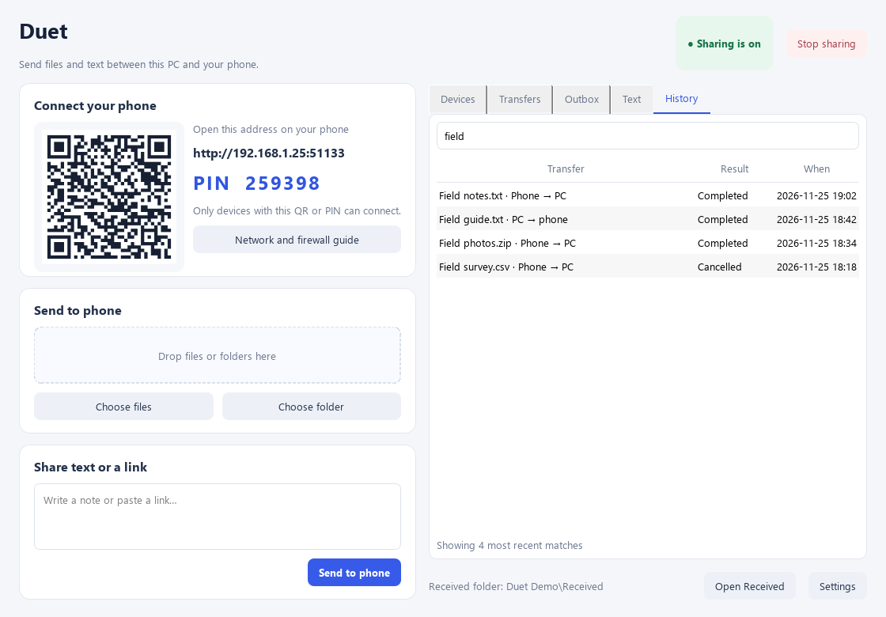
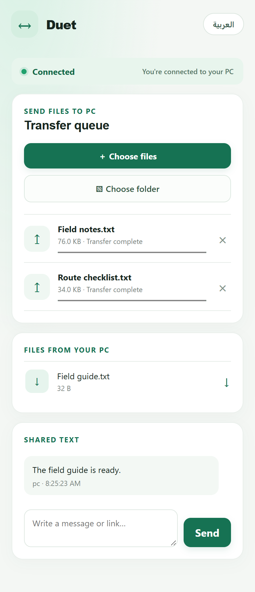

# Duet

Duet shares files, folders and text between a Windows or Linux PC and a phone on the same private network. Open Duet on the PC, then pair from the phone’s browser with a QR code or PIN.

## Screenshots

In the desktop app, the History tab shows completed and interrupted transfers and lets you search by filename.



The phone page shows uploads, files offered from the PC, and shared text.



## Install Duet

- **Windows**. Download the installer artifact, unzip it and run the setup executable. Open Duet from the Start menu.
- **Debian and Ubuntu**. Download and unzip the Linux artifact. Install the package with `sudo apt install ./<downloaded-file>.deb`, then open Duet from the application menu.

Get the artifacts from a successful run of the packaging workflow. GitHub Actions requires sign-in to download workflow artifacts. See [Package Duet](https://github.com/Ahmed41022/Duet/actions/workflows/packages.yml).

For a Python install, build the wheel using the steps below, then run `python -m pip install "./dist/<wheel-filename>.whl[desktop]"` with the actual wheel filename. The `desktop` extra adds Qt and the `duet-desktop` command launches the app.

## Development setup

Install Python 3.11 or later. To build or preview the phone web app, also install Node.js 22.12 or later with npm.

Create a virtual environment with `python -m venv .venv`. Activate it with `.venv\Scripts\Activate.ps1` in Windows PowerShell or `source .venv/bin/activate` on Linux. Then run:

```sh
python -m pip install -e ".[dev]"
duet --version
python -m pytest -q
python -m ruff check .
python -m ruff format --check .
```

The Python suite runs without Qt, a browser, or a phone.

## Phone web app and Python package

From the repository root, run:

```sh
npm ci --prefix web
npm run build --prefix web
python -m build
```

Vite writes the static bundle to `src/duet/server/static/`. Build the web app before creating distribution archives so the bundle is included. The wheel and source distribution appear in `dist/`.

To preview the starter page while editing it, run `npm run dev --prefix web` and open the local address Vite prints.

## Configuration

`duet.core.config.load_config()` provides defaults without creating files or directories. Python callers can pass a TOML file to override them. Relative received directories resolve from that file's directory.

```toml
received_directory = "Received"
idle_timeout_seconds = 900
log_level = "INFO"
```

The default received directory is `Duet/Received` under the user's home directory.

## Pair a phone

Build the web bundle as described above, then run `duet serve` in a terminal. Connect your phone to the same private network and scan the QR code. A new pairing offer appears after each use. Use `duet serve --bind 192.168.1.10` to select a specific private address assigned to your PC. Press Ctrl+C to stop the server.

## Receive files

Use `duet serve --config settings.toml` to select a Received folder or upload limits. Set `max_file_size` in bytes and `max_parallel_uploads` per paired device. The defaults allow any file size that fits on disk and three active uploads per device. Interrupted uploads can resume while the same server and pairing session are active.

## Use the phone page

Scan the QR code or open the displayed address and enter the six-digit PIN. Choose files or a folder to upload. If the browser reloads, tap **Resume** and select the original file. Use the language button to switch between English and Arabic. Paired devices and the desktop can exchange text while the server is running.

## Send a file or folder to a phone

Run `duet send "path/to/item"` on the PC. This adds the item to the local outbox. While the server is running, paired phones see the new offer automatically. The phone downloads a regular file directly or receives a folder as a ZIP. If the source changes, add it again to offer the new version.

## Launch the desktop app

For a source checkout, build the web bundle as described above, install the desktop extra with `python -m pip install -e ".[desktop]"`, then run `duet-desktop`. Click **Start sharing** to display the QR code and PIN. The Devices tab lets you revoke a phone. Use the Transfers tab to see active transfers and the Text tab to read messages from a phone. Search the History tab by all or part of a filename. It shows up to 100 of the most recent matches across saved transfers. Duet sends tray notifications when files arrive if the system tray supports notifications. You can also run `duet devices` and `duet history` in a terminal.

Settings lets you choose the Received folder and idle timeout. Folder and bind-address changes apply the next time you start sharing. Close the window or use **Quit Duet** in its tray menu to stop sharing.

## Use a PC hotspot

The address selector prefers a reachable hotspot or Wi-Fi adapter. The server stops after inactivity or when its assigned address disappears. Follow the [Wi-Fi, hotspot and firewall guide](docs/network.md) for Windows and Linux setup and the physical-device test checklist.

See the [project plan](docs/PLAN.md) for the milestones.
